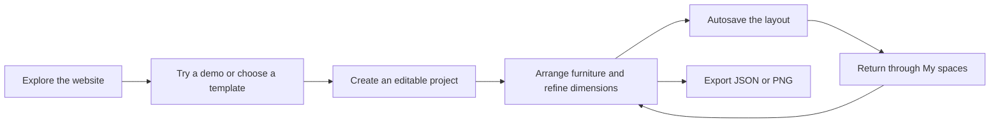
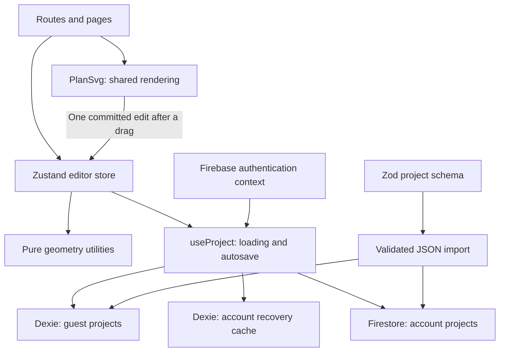
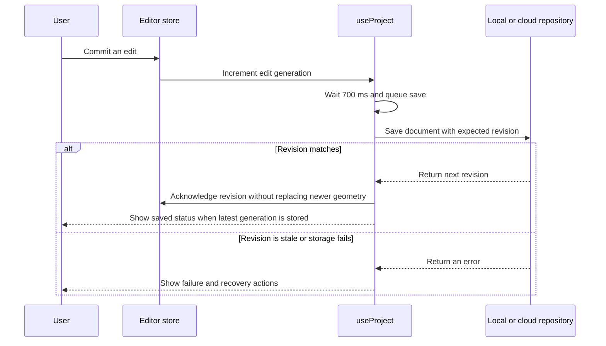

# SPACEFIT

### Make room for better living.

A home layout planning platform that connects a warm, architectural brand experience with an interactive 2D room editor. Plan a room with real dimensions, try different furniture arrangements, and return to a saved layout before moving a single piece of furniture.

**[Visit the live website →](https://space-fit-six.vercel.app/)**

[Source code](https://github.com/dongyunkim96/SpaceFit) · [Creator: @dongyunkim96](https://github.com/dongyunkim96) · [Verification record](QA.md)

Built with **React, TypeScript, Vite, SVG, Zustand, Dexie, and Firebase integration**. Hosted on **Vercel**. The product interface and this documentation are in English.

> **Try it without an account:** Open the live website, choose **Explore a demo**, and start arranging. Guest projects save in that browser. Account sign-in and cloud storage require a configured Firebase project; deploying the frontend alone does not enable those services.

## Contents

- [Why I built SPACEFIT](#why-i-built-spacefit)
- [How to explore the product](#how-to-explore-the-product)
- [Features and routes](#features-and-routes)
- [Design approach](#design-approach)
- [Technology choices](#technology-choices)
- [Architecture and project structure](#architecture-and-project-structure)
- [A guided tour of the code](#a-guided-tour-of-the-code)
- [How the planner works](#how-the-planner-works)
- [Project data and validation](#project-data-and-validation)
- [Saving, accounts, and conflict recovery](#saving-accounts-and-conflict-recovery)
- [Local setup](#local-setup)
- [Firebase setup and deployment](#firebase-setup-and-deployment)
- [Testing and verification](#testing-and-verification)
- [Challenges and lessons](#challenges-and-lessons)
- [Current limitations and next steps](#current-limitations-and-next-steps)
- [Assets and references](#assets-and-references)

## Why I built SPACEFIT

I built SPACEFIT around a practical question: **“Will this arrangement actually work in my room?”** A sofa can look right in a photograph and still block a doorway. A desk can fit against a wall while leaving too little room for the rest of everyday life. I wanted to make those decisions easier to explore before buying or moving furniture.

My goal was to connect two experiences: a brand website that explains the idea clearly, and a planning tool that lets someone act on it immediately. The homepage introduces the product through an interactive floor plan. Templates give visitors a starting point. The editor turns that starting point into an editable, saved project.

I approached the project across product structure, visual design, frontend implementation, geometry, persistence, and testing. The decisions I wanted the code to demonstrate were:

- **Keep exploration approachable.** A visitor can try the core editor without registering first.
- **Make the dimensions meaningful.** Furniture positions and sizes use a real-world measurement model rather than arbitrary screen pixels.
- **Make experimentation reversible.** Moving, rotating, duplicating, undoing, and saving should support trying another idea.
- **Treat storage as part of the experience.** The interface distinguishes a browser draft, a cloud save, an offline edit, and a failed save.
- **Give the brand and tool a shared identity.** The same floor-plan renderer appears in marketing previews, templates, project cards, and the editor.

SPACEFIT is a fictional brand and a conceptual planning product. The project does not invent customers, testimonials, partnerships, or professional certifications.

## How to explore the product

Start at **[space-fit-six.vercel.app](https://space-fit-six.vercel.app/)**.

1. Select **Explore a demo** to open a furnished room, or browse **Templates** for a different starting point.
2. Create an editable copy and enter a project name. For a blank room, enter its width and depth.
3. Add furniture from the catalog, then select a piece to move, rotate, resize, duplicate, or recolor it.
4. Check the save indicator. Guest projects identify their storage location as **This browser**.
5. Return through **My spaces** to continue editing, or export a JSON backup and a PNG floor plan.



**Browser storage belongs to the website origin.** A draft created on `localhost` will not automatically appear on the Vercel deployment. Export its JSON file locally and import that file on the live site to move it between the two. Different browsers and devices also have separate guest storage.

## Features and routes

### Brand website and discovery

| Route        | What it does                                                                                         | Main implementation                      |
| ------------ | ---------------------------------------------------------------------------------------------------- | ---------------------------------------- |
| `/`          | Brand introduction, interactive layout preview, before/after comparison, featured templates, and FAQ | [Home.tsx](src/pages/Home.tsx)           |
| `/about`     | Product purpose, design principles, capabilities, and boundaries                                     | [About.tsx](src/pages/About.tsx)         |
| `/templates` | Eight layouts with room-type, area, furnishing, and search filters                                   | [Templates.tsx](src/pages/Templates.tsx) |
| `/new`       | Validated project setup from a template or a blank rectangular room                                  | [NewSpace.tsx](src/pages/NewSpace.tsx)   |
| `/demo`      | Creates and saves a new editable demo, then opens its planner                                        | [main.tsx](src/main.tsx)                 |

The homepage is connected to the product: a layout edited in its preview can be passed into an editable project rather than remaining a decorative image.

### Planning, projects, and accounts

| Route                                      | What it does                                                                           | Main implementation                        |
| ------------------------------------------ | -------------------------------------------------------------------------------------- | ------------------------------------------ |
| `/planner/:projectId`                      | SVG room editor, catalog, selected-item properties, history, view controls, and export | [Planner.tsx](src/pages/Planner.tsx)       |
| `/my-spaces`                               | Saved previews, search, sort, rename, duplication, confirmed deletion, and JSON import | [Dashboard.tsx](src/pages/Dashboard.tsx)   |
| `/sign-in`, `/sign-up`, `/forgot-password` | Firebase email/password account flows when configured                                  | [Account.tsx](src/pages/Account.tsx)       |
| `/help`, `/privacy`, unmatched paths       | Planning guidance, actual storage behavior, and an actionable 404 page                 | [Supporting.tsx](src/pages/Supporting.tsx) |

### Layout and furniture library

The eight templates cover compact and standard bedrooms, a home office, a living room, a dining room, and studio, one-bedroom, and two-bedroom apartments. They offer furnished and blank variants. Apartment areas are calculated from their room rectangles, rather than copied from a target-area label.

The catalog contains **41 furniture entries across five categories**. Each entry defines a stable ID, example dimensions, height, footprint type, color, editable limits, and collision layer. Sofas, beds, chairs, tables, desks, storage, plants, rugs, and lamps use recognizable top-down SVG details.

These are illustrative furniture footprints, not specifications for a particular manufacturer. Bed footprints include a sample frame; they should not be treated as mattress-only measurements.

## Design approach

I used an architectural editorial style to make the product feel thoughtful while keeping the editor precise. The visual language comes from the planning task itself: room outlines, measurement annotations, soft grids, furniture silhouettes, and restrained material colors.

| Design decision                         | Purpose                                                                  |
| --------------------------------------- | ------------------------------------------------------------------------ |
| Warm ivory and muted sage surfaces      | Separate the page, workspace, and panels without heavy visual noise      |
| Forest green controls and clay accents  | Establish a consistent interaction hierarchy                             |
| Serif headings with sans-serif controls | Give the brand an editorial voice while keeping forms and tools readable |
| Shared SVG floor plans                  | Show actual product data instead of unrelated decorative illustrations   |
| Compact planner shell                   | Preserve workspace area once a visitor starts editing                    |
| Mobile catalog and properties sheets    | Reorganize the workflow instead of shrinking the desktop panels          |

The interface also includes visible focus indicators, descriptive icon-button names, keyboard alternatives to dragging, native modal dialogs, and reduced-motion support. Those measures support accessibility; they are not a claim of complete assistive-technology or WCAG certification.

Visual tokens, responsive layouts, and component styles live in [src/styles.css](src/styles.css). Shared navigation, the logo, footer, and final call to action live in [Brand.tsx](src/components/Brand.tsx).

## Technology choices

| Technology                          | Role in this project                                  | Reason for the choice                                                          |
| ----------------------------------- | ----------------------------------------------------- | ------------------------------------------------------------------------------ |
| React + strict TypeScript           | Components, routes, and typed project data            | Keep UI behavior and data contracts understandable as the editor grows         |
| Vite                                | Local development and production builds               | Build the application as a client-rendered frontend                            |
| Tailwind CSS v4 + CSS               | Styling integration, tokens, and responsive rules     | Combine the Vite plugin with a project-specific visual system                  |
| React Router                        | Marketing and application routes                      | Let discovery, setup, the dashboard, and editing share one application         |
| SVG                                 | Rooms, openings, furniture, selection, and dimensions | Map geometric data directly to inspectable vector elements without a 3D engine |
| Zustand                             | Editor state and history                              | Give editor controls a shared source of truth outside component-local state    |
| React Hook Form + Zod               | Forms and runtime validation                          | Validate entered data and imported documents as well as TypeScript types       |
| Dexie / IndexedDB                   | Guest projects and account recovery caches            | Persist structured documents in the browser without requiring registration     |
| Firebase Authentication + Firestore | Optional accounts and user-owned projects             | Add identity and account storage through separate adapters                     |
| Vitest + Testing Library            | Geometry, state, storage, and component tests         | Test rules and behavior independently of full browser flows                    |
| Playwright + axe                    | Browser workflows and automated accessibility checks  | Exercise real interaction, persistence, exports, and responsive states         |
| Vercel                              | Published frontend                                    | Provide the live website linked at the top of this README                      |

Dependency ranges are declared in [package.json](package.json); exact installed versions are recorded in [package-lock.json](package-lock.json).

## Architecture and project structure

I separated rendering, editing, geometry, and storage so that a change to one concern does not have to be implemented inside a single large component. The planner page composes the interface, while smaller modules define what an edit means and how it is saved.

```text
SpaceFit/
├── src/
│   ├── main.tsx                 # Application entry, providers, routes, lazy loading
│   ├── styles.css               # Brand styles, editor layout, responsive behavior
│   ├── components/
│   │   ├── Brand.tsx            # Shared marketing navigation and brand elements
│   │   ├── Dialog.tsx           # Native dialog wrapper and focus restoration
│   │   ├── PlanSvg.tsx          # Reusable floor-plan and furniture renderer
│   │   └── TemplateCard.tsx     # Template preview and editable-copy entry point
│   ├── data/
│   │   ├── catalog.ts           # Structured furniture definitions
│   │   └── templates.ts         # Room geometry, sample layouts, project factories
│   ├── lib/
│   │   ├── model.ts             # Zod schemas, inferred types, project copying
│   │   ├── geometry.ts          # Unit conversion, bounds, snapping, overlaps
│   │   ├── editor.ts            # Zustand actions, selection, undo/redo
│   │   ├── persistence.ts       # Dexie adapter, revision checks, file exports
│   │   ├── firebase.ts          # Deferred Firebase initialization and cloud adapter
│   │   ├── auth.tsx             # Authentication context and session subscription
│   │   └── useProject.ts        # Project loading, autosave, offline recovery
│   └── pages/                   # Brand, setup, editor, dashboard, account, help
├── tests/
│   ├── geometry.test.ts         # Measurement, template, schema, editor tests
│   ├── components.test.tsx     # Filtering and accessible dialog behavior
│   ├── storage.test.ts         # Persistence, revisions, cache isolation
│   ├── firebase.rules.test.ts  # Firestore ownership and revision integration tests
│   └── e2e/                    # Guest, account, pointer, regression, visual flows
├── firestore.rules             # Server-enforced document access rules
├── firebase.json               # Emulator ports and Firebase Hosting configuration
├── .env.example                # Public Firebase configuration placeholders
├── .env.emulator               # Local demo-only Firebase configuration
├── playwright.config.ts        # Guest browser test configuration
├── playwright.firebase.config.ts # Account browser test configuration
├── QA.md                       # Recorded results and verification limits
└── README.md
```



### A guided tour of the code

For a first read, I recommend this order:

1. **[main.tsx](src/main.tsx)** — Understand how the application starts, which pages share the marketing shell, and why the editor has its own route. Most secondary pages and the planner are loaded with `React.lazy`.
2. **[model.ts](src/lib/model.ts)** — Read the document structure before the UI. `Project`, `Room`, `Opening`, and `Item` are inferred from runtime schemas rather than maintained as separate, potentially divergent definitions.
3. **[templates.ts](src/data/templates.ts)** and **[catalog.ts](src/data/catalog.ts)** — See how initial room geometry and reusable furniture definitions become editable project instances. `createProject`, `createDemo`, and `copyProject` have different responsibilities.
4. **[geometry.ts](src/lib/geometry.ts)** — Follow `parseLength`, `footprint`, `constrain`, `overlaps`, and `bounds`. These functions express the measurement and placement rules without depending on React.
5. **[editor.ts](src/lib/editor.ts)** — Trace a single action such as `updateItem`. It creates a project snapshot, applies the proposed edit, checks room bounds, and records a history step only when the document changes.
6. **[PlanSvg.tsx](src/components/PlanSvg.tsx)** — Follow how document data becomes SVG elements and how pointer coordinates become world coordinates. Temporary drag state stays in the renderer until release.
7. **[useProject.ts](src/lib/useProject.ts)** — Follow a durable edit through the debounce timer, save queue, revision check, save indicator, and recovery actions.
8. **[persistence.ts](src/lib/persistence.ts)** and **[firebase.ts](src/lib/firebase.ts)** — Compare the local and account adapters. Both expose `list`, `get`, `save`, and `remove`, but use different storage mechanisms.
9. **[Planner.tsx](src/pages/Planner.tsx)** — Return to the composed UI: catalog, canvas, properties, room controls, shortcuts, and export tools.
10. **[tests/](tests/)** — Read the tests alongside each module to see the expected behavior and the edge cases the implementation protects.

## How the planner works

### 1. One measurement model, multiple display units

I store room sizes, furniture sizes, and positions in **millimeters**. Feet/inches and centimeters are input and display formats. Changing the display unit updates `project.unit`; it does not rescale or repeatedly round the stored geometry.

For example, `12' 6"`, `150` total inches, and `381` centimeters all represent **3,810 mm**. On the plan, labels can use rounded display values while the numeric editing fields retain more precision.

| Rule                   | Value                                                            |
| ---------------------- | ---------------------------------------------------------------- |
| Room width/depth       | 100–30,000 mm                                                    |
| Furniture width/depth  | 100–6,000 mm, also constrained by room fit during ordinary edits |
| Grid step              | 50 mm                                                            |
| Arrow-key movement     | 50 mm                                                            |
| Shift + Arrow movement | 250 mm                                                           |
| Rotation               | 0°, 90°, 180°, or 270°                                           |
| Project limits         | 30 rooms, 200 openings, 500 furniture items                      |

See [geometry.ts](src/lib/geometry.ts) for conversion and placement rules, and [model.ts](src/lib/model.ts) for document limits.

### 2. SVG coordinates are separate from screen pixels

The SVG `viewBox` represents the visible world area. Its size and position change when someone zooms or pans; the document's furniture coordinates do not.

Pointer interaction uses the inverse SVG screen transformation through `getScreenCTM().inverse()`. This accounts for the SVG's scale and position, including the rotated homepage preview. The initial transformation is retained during an interaction so that updating the view while panning does not make the pointer calculation drift.

The pure `pointerToWorld` utility provides a corresponding conversion for a letterboxed viewport and is tested independently.

### 3. A drag is one edit

During a drag, the renderer updates temporary local coordinates to show the moving item. It snaps and clamps those proposed coordinates when appropriate. On pointer release, it calls the store's update action once.

```text
Pointer down → select item and capture starting coordinates
Pointer move → update temporary visual position
Pointer up   → commit the final position to the editor store
             → record one undo step and schedule autosave
```

This keeps intermediate pointer events out of the saved document and prevents a single drag from requiring dozens of undo actions.

### 4. History stores document snapshots

The Zustand store keeps `past`, the current `project`, and `future`. An edit clones the document, applies a mutation, and compares it with the current document. An unchanged result does not create a history entry. A changed result adds the previous document to history and clears redo history.

Undo/redo preserves the current persistence revision. Returning to an older arrangement must not make the next save pretend that it is based on an older server revision.

I chose snapshot history for a straightforward, inspectable implementation, capped at **50 past states**. The tradeoff is that cloning and comparison cost grows with document size; a command-based history would be worth considering for substantially larger projects.

### 5. Boundaries and overlaps are planning feedback

Quarter-turn rotation swaps the furniture footprint's width and depth. `constrain` keeps ordinary movement inside the assigned room. Resizing a room does not silently delete furniture; pieces outside the new boundary remain visible and generate a notice.

Solid-furniture overlap checks use axis-aligned rectangles after rotation. Rugs use a floor layer so that furniture resting above them is not automatically considered a conflict. Doors and windows are anchored to a room wall; their visible span is clamped when a room is resized. Door-swing notices use a conservative square envelope.

These are conceptual layout hints, not structural, legal-clearance, accessibility, or building-code assessments.

### 6. Exports serve two different purposes

- **JSON** contains the complete project document for backup and later editing. Import validates the document and assigns a new project ID to create an independent copy.
- **PNG** serializes the current SVG, draws it onto an 1800 × 1400 canvas, and downloads an image. It captures the current view, including selection annotations and zoom. Use **Fit** first for a complete-plan image.

Both are implemented in [persistence.ts](src/lib/persistence.ts).

## Project data and validation

The current project schema version is **1**. A project stores the layout and metadata needed to reopen it; it does not store every detail of the current interface.

| Field                    | Meaning                                                                                      |
| ------------------------ | -------------------------------------------------------------------------------------------- |
| `schemaVersion`          | Version used to validate the document format                                                 |
| `id`, `name`             | Project identity and display name                                                            |
| `rooms`                  | Rectangles with names, positions, dimensions, and notes                                      |
| `openings`               | Doors/windows with a room reference, wall, relative position, and width                      |
| `furniture`              | Editable instances with a catalog reference, room, dimensions, position, rotation, and color |
| `unit`                   | Preferred measurement display: `imperial` or `metric`                                        |
| `createdAt`, `updatedAt` | ISO timestamps for project metadata                                                          |
| `revision`               | Version used to detect stale writes                                                          |

**Document state** includes room dimensions, furniture arrangements, notes, and display units. **Session/UI state** includes selection, open panels, drag previews, pan, zoom, and history. Keeping those concerns separate prevents a temporary selection or camera position from becoming an unnecessary saved edit.

TypeScript checks code at development time. Zod checks data at runtime, including imported JSON. The project schema verifies finite numbers, ranges, colors, supported rotations, room references, and unique room/furniture IDs. Imports larger than 2 MB are rejected before parsing.

IndexedDB schema version **2** adds a separate account-recovery cache to the original guest-project table. That database version is separate from the project-document version. Unsupported project versions are currently rejected; future format changes need explicit migrations and fixture tests.

## Saving, accounts, and conflict recovery

### Two repositories, one editing workflow

|                           | Guest project                               | Account project                                    |
| ------------------------- | ------------------------------------------- | -------------------------------------------------- |
| Identity                  | No sign-in required                         | Firebase Authentication user                       |
| Primary storage           | Browser IndexedDB through Dexie             | Cloud Firestore                                    |
| Location                  | `spacefit-drafts` → `projects`              | `/users/{uid}/projects/{projectId}`                |
| Local recovery            | The guest document itself                   | Separate UID-scoped `accountCache` entries         |
| Cross-device availability | Requires manual JSON transfer               | Requires a configured account and cloud connection |
| Save verification         | IndexedDB transaction and expected revision | Firestore transaction and expected revision        |

Guest drafts remain on their browser origin. Clearing site data, private-browsing cleanup, or browser eviction can remove them. Export backups for anything important. Signing in does not automatically move those drafts into an account: **My spaces** offers an opt-in import, and imported copies get new project IDs.

### The autosave lifecycle



The implementation uses an edit `generation` to track local changes and a persisted `revision` to track accepted writes. Save requests are serialized. A save response acknowledges its revision without replacing the editor's newer geometry. Navigation through planner links flushes pending changes; full-page unload warns when edits remain unsaved.

### Offline edits and conflicts

For an already opened account project, offline edits are kept in a local cache and labeled **Offline — changes kept locally**. Reconnection triggers another save attempt. If another tab or device has advanced the document revision, the app exposes a conflict instead of silently overwriting it.

**Save a copy** preserves the current arrangement under a new project ID. **Reload latest** discards that pending recovery cache and reloads the stored version. Completing a conflict copy clears the original recovery entry so that it does not later reopen an obsolete arrangement.

The app is not a PWA: this behavior does not guarantee that the application or every project can be opened for the first time without a network connection.

### Authentication and authorization are separate

[auth.tsx](src/lib/auth.tsx) subscribes to Firebase authentication and exposes the current session. Account initialization is deferred in [firebase.ts](src/lib/firebase.ts). Loading requests and editor rendering are scoped to the current user/project to avoid showing an old session's result after an account change.

The frontend chooses the user's project path, but **[firestore.rules](firestore.rules) enforces access on the server**. The rules check ownership, allowed top-level fields, collection sizes, document IDs, immutable creation timestamps, and sequential revisions. The client Zod schema adds nested geometry validation; client validation is not a substitute for server authorization.

## Local setup

### Requirements

- Node.js **20.19+ or 22.12+** and npm for the frontend.
- Git for cloning the repository.
- Java **21+** on PATH for the Firestore emulator only; guest planning does not require Java or Firebase credentials.

### Install and start

```sh
git clone https://github.com/dongyunkim96/SpaceFit.git
cd SpaceFit
npm ci
npm run dev
```

Open the local URL printed by Vite, normally **http://127.0.0.1:5173/**. If that port is occupied, use the URL Vite actually reports.

On Windows PowerShell, use `npm.cmd ci` and `npm.cmd run dev` if PowerShell's execution policy blocks the `npm.ps1` wrapper. Git must also be installed and available on PATH.

### Available commands

| Command                 | Purpose                                                                                               |
| ----------------------- | ----------------------------------------------------------------------------------------------------- |
| `npm run dev`           | Start the standard frontend; guest mode works without Firebase                                        |
| `npm run dev:emulator`  | Start the account-enabled frontend on port 5175 using `.env.emulator`; start the emulators separately |
| `npm run typecheck`     | Check strict TypeScript types                                                                         |
| `npm run lint`          | Run ESLint                                                                                            |
| `npm test`              | Run the standard Vitest tests                                                                         |
| `npm run test:e2e`      | Run guest browser workflows and visual checks                                                         |
| `npm run test:rules`    | Start emulators and run Firestore rules tests                                                         |
| `npm run test:firebase` | Start emulators, run rule tests and account browser tests, then shut down                             |
| `npm run build`         | Type-check and create production assets in `dist/`                                                    |
| `npm run preview`       | Serve the existing production build locally                                                           |
| `npm run format`        | Format project sources and selected root files with Prettier                                          |

## Firebase setup and deployment

### Why sign-in may be unavailable

The frontend and account backend are configured separately. Without the required Firebase public web settings, the account screen displays **“Guest planning is ready”** and disables sign-in. This is intentional configuration feedback, not a simulated login. The guest planner remains usable.

The checked-in `.env.emulator` is a **local demo configuration**, not a production Firebase account. Its Auth/Firestore endpoints point to `127.0.0.1` and must not be used as the live site's account backend.

### Enable real account storage

1. Create a Firebase project and register a web application.
2. Enable **Email/Password** under Firebase Authentication.
3. Create a Cloud Firestore database.
4. Copy [.env.example](.env.example) to `.env.local` and replace its placeholders with the project's public web configuration.
5. Add `space-fit-six.vercel.app` and any custom production hostname to Firebase Authentication's authorized domains.
6. Deploy the ownership rules to that Firebase project.

```sh
npx firebase login
npx firebase deploy --only firestore:rules --project YOUR_PROJECT_ID
```

| Variable                      | Purpose                                                     |
| ----------------------------- | ----------------------------------------------------------- |
| `VITE_FIREBASE_API_KEY`       | Firebase public web API key                                 |
| `VITE_FIREBASE_AUTH_DOMAIN`   | Firebase authentication domain                              |
| `VITE_FIREBASE_PROJECT_ID`    | Firebase project identifier                                 |
| `VITE_FIREBASE_APP_ID`        | Registered Firebase web application identifier              |
| `VITE_USE_FIREBASE_EMULATORS` | `true` for local emulators; `false` or unset for production |

For the Vercel deployment, provide the production values in the deployment environment **before building**, then redeploy after changing them. Vite embeds public configuration into the browser bundle. These are public client settings; administrator credentials and service-account keys must never be included in `VITE_` variables.

### Frontend deployment details

The published frontend is available at **[https://space-fit-six.vercel.app/](https://space-fit-six.vercel.app/)**. Its source repository is **[dongyunkim96/SpaceFit](https://github.com/dongyunkim96/SpaceFit)**.

The project builds with `npm run build` and emits `dist/`. It uses browser-history routing, so the hosting setup must serve `index.html` for application routes such as `/templates` and `/my-spaces` when opened directly or refreshed. The repository includes a Firebase Hosting rewrite in [firebase.json](firebase.json); that file is not a Vercel routing configuration.

### Test accounts locally with emulators

With Java 21+ available on PATH:

```sh
# Terminal 1: local Auth and Firestore services
npx firebase emulators:start --only auth,firestore --project demo-spacefit

# Terminal 2: frontend connected to those services
npm run dev:emulator
```

Open **http://127.0.0.1:5175/** and create a local test account. Auth runs on port **9099**, Firestore on **8080**, and the emulator UI is configured for **4000**. These accounts are separate from production accounts. Emulator data is temporary unless an explicit emulator import/export workflow is configured.

Alternatively, `npm run test:firebase` starts and stops the services around the automated account tests. The original Windows verification used an ignored portable Java runtime under `.tools/java`; that folder is not included in a fresh clone, so other machines need their own Java installation.

## Testing and verification

I split verification by responsibility so a geometry failure can be investigated separately from a browser-navigation or cloud-permission failure.

| Test area                   | Files                                                  | What it checks                                                                                                         |
| --------------------------- | ------------------------------------------------------ | ---------------------------------------------------------------------------------------------------------------------- |
| Geometry, model, and editor | [geometry.test.ts](tests/geometry.test.ts)             | Units, pointer conversion, grid, rotations, room bounds, overlap behavior, valid templates, schemas, copies, undo/redo |
| Components                  | [components.test.tsx](tests/components.test.tsx)       | Template filters, empty results, and accessible dialog behavior                                                        |
| Local persistence           | [storage.test.ts](tests/storage.test.ts)               | Layout restoration, stale revisions, concurrent writes, and account-cache isolation                                    |
| Server authorization        | [firebase.rules.test.ts](tests/firebase.rules.test.ts) | Ownership, anonymous access rejection, sequential revisions, immutable creation time                                   |
| Guest workflows             | [flows.spec.ts](tests/e2e/flows.spec.ts)               | Demo entry, editing, save/reload, JSON round trip, PNG validity, mobile editing, invalid import, axe scans             |
| Pointer interaction         | [pointer.spec.ts](tests/e2e/pointer.spec.ts)           | Panning and dragging after zoom, including single-step undo                                                            |
| Regression scenarios        | [regressions.spec.ts](tests/e2e/regressions.spec.ts)   | Unit-switch preservation, immediate-navigation saving, selected-planner axe scan, 100-piece editing                    |
| Account workflows           | [account.spec.ts](tests/e2e/account.spec.ts)           | Signup, guest import, cloud persistence, sign-out/sign-in, offline/reconnect, and two-tab conflict recovery            |
| Responsive visuals          | [visual.spec.ts](tests/e2e/visual.spec.ts)             | Screenshots and overflow checks at 360, 768, and 1440 px                                                               |

Run the relevant checks with:

```sh
npm run typecheck
npm run lint
npm test
npx playwright install chromium
npm run test:e2e

# Also requires Java 21+; runs against the demo Firebase emulators
npm run test:firebase

npm run build
```

The standard browser suite intentionally skips the account test when emulators are not present. `test:firebase` runs it with emulated authentication and Firestore rather than fake successful responses.

The recorded local verification includes **22 unit/component/storage tests**, Firestore rule integration tests, guest and account browser flows, selected-furniture pointer tests, and responsive screenshots. The evidence and limits are documented in **[QA.md](QA.md)**. Those are recorded development results, not a claim that this README update reran the suite or that every feature has been verified against the production deployment.

Visual test screenshots are generated into the ignored `qa/` directory. They are local review artifacts, not required runtime assets. Lighthouse scores, full cross-browser coverage, and complete screen-reader conformance have not been measured or certified.

## Challenges and lessons

### Accurate interaction depends on the coordinate model

Zoom, pan, padding, and the rotated homepage preview made screen pixels an unreliable substitute for world coordinates. Using the SVG screen transformation and testing pointer interaction after zoom kept the model independent of how the canvas is displayed.

### Saving is more than writing a document

An edit could be lost if a visitor left before the debounce timer ran. Planner navigation now flushes pending changes. Concurrent edits needed a separate solution: save queues establish ordering, while revisions detect writes based on an older document.

### Recovery state needs its own lifecycle

Multi-tab testing exposed a case where saving a conflicting arrangement as a copy left an obsolete recovery cache for the original. The copy operation and Reload latest now clean up that cache. This reinforced the need to test returning to a project, not only the first successful save.

### A shared renderer makes previews more useful

Reusing `PlanSvg` keeps the homepage, templates, dashboard previews, and editor tied to the same geometric model. A change to furniture rendering can be reflected across those surfaces without maintaining separate illustrative images.

### Mobile editing needs a different arrangement of controls

The desktop editor uses catalog, canvas, and properties columns. On mobile, those panels become sheets controlled from the bottom navigation. Numeric dimensions and positions also keep the core workflow available when dragging is inconvenient.

## Current limitations and next steps

The current implementation focuses on conceptual 2D room planning. These boundaries are deliberate or still unfinished, and are useful context when reviewing the code:

| Current boundary                                                              | Possible next step                                                                     |
| ----------------------------------------------------------------------------- | -------------------------------------------------------------------------------------- |
| Rooms are rectangular and new rooms attach to the right                       | Add room repositioning and richer multi-room composition                               |
| Template doors/windows are wall-anchored but have no custom opening editor    | Add validated opening placement and editing tools                                      |
| Furniture is inserted by click/tap                                            | Add optional catalog-to-canvas dragging while preserving the accessible insertion path |
| Rotations use quarter turns and overlaps use rectangles                       | Evaluate richer geometry if product needs justify the complexity                       |
| PNG exports show the current canvas view                                      | Add a dedicated clean export view with explicit scale and annotation options           |
| Guest storage is browser/origin-specific                                      | Improve backup guidance and recovery workflows                                         |
| Offline editing assumes an already loaded app/project                         | Consider explicit PWA caching and offline project discovery                            |
| History uses document snapshots and overlap analysis can grow with item count | Profile larger documents before adopting command history or spatial indexing           |

Account recovery caches are not encrypted at rest. Production Firebase email delivery, quotas, and billing behavior require the configured deployment's services. Template and catalog dimensions must be checked against real measurements before making purchasing or construction decisions.

## Assets and references

Room diagrams, furniture footprints, floor textures, logo linework, and editorial artwork are local SVG/CSS created for this project. The application does not depend on stock-photo services or remote font requests. Georgia and Arial use the visitor's system installation and are not redistributed. Lucide icons are supplied through `lucide-react` under the ISC license; dependencies retain their respective licenses.

References used during implementation:

- [Vite setup](https://vite.dev/guide/)
- [Tailwind CSS with Vite](https://tailwindcss.com/docs/installation/using-vite)
- [Dexie React guidance](https://dexie.org/docs/Tutorial/React)
- [Firebase Authentication emulator](https://firebase.google.com/docs/emulator-suite/connect_auth)
- [Firebase Emulator Suite setup](https://firebase.google.com/docs/emulator-suite/install_and_configure)

**Project creator:** [@dongyunkim96](https://github.com/dongyunkim96) · **Live website:** [SPACEFIT](https://space-fit-six.vercel.app/)
